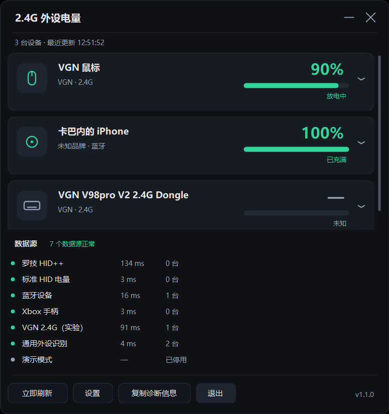
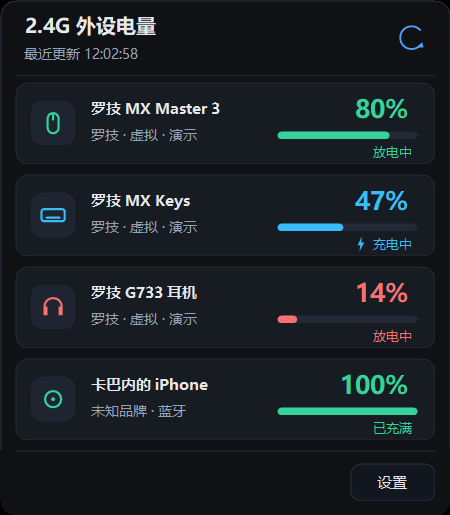
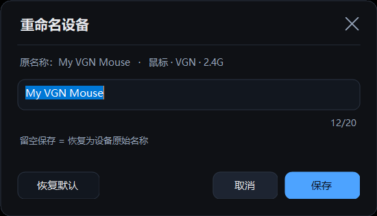
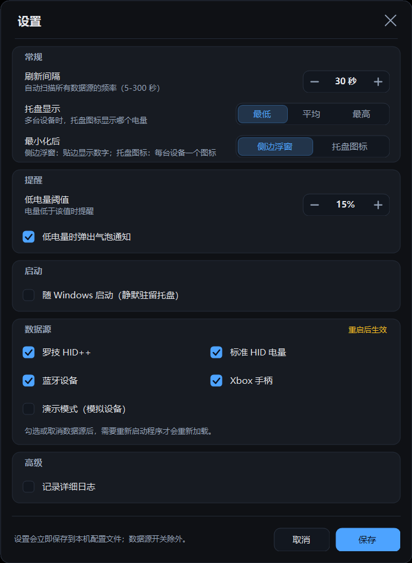
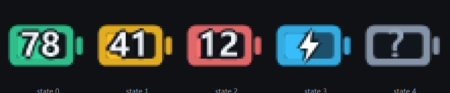

# 2.4G 外设电量监控

常驻 Windows 通知区域的轻量电量监控工具：把 2.4G / 蓝牙无线外设（鼠标、键盘、耳机、手柄）的电量放在右下角，随时能看。

**绿色免安装**：单个 exe，只依赖 Windows 自带的 .NET Framework 4.8；无驱动、无需管理员、不联网、不上传任何数据。

> **English**: a lightweight Windows tray app showing real-time battery levels of 2.4G / Bluetooth peripherals. Built with .NET Framework 4.8 (csc only, no NuGet), no drivers, no telemetry. Supports Logitech HID++, VGN private HID protocols, BLE battery, and Xbox controllers. Licensed under MIT.



## 功能

- **托盘实时电量**：动态电池图标 + 圆环数字，绿（≥50%）/ 黄（20–49%）/ 红（<20%）/ 蓝（充电）/ 灰（未知）；多设备时默认显示电量最低的一台（可在设置里改为平均/最高）。
- **悬浮面板**：左键托盘图标，列出全部设备、电量条、充电状态；点“设置”可直接调整。
- **主面板**：设备详情（品牌、连接方式、VID:PID、电压、数据源、HID 路径）+ 数据源健康状态（每个 Provider 的耗时与错误）。
- **全品牌可见**：读不到电量的 2.4G 设备也会按“鼠标 / 键盘 / 耳机 / 手柄”列出来（电量显示“未知”），不会因为品牌不支持就完全看不见。
- **自定义名称**：任意设备都可以重命名（≤20 字），保存后主面板、悬浮面板、托盘提示同步生效。
- **低电量提醒**：低于阈值（默认 20%）弹一次气泡，回到阈值 +5 以上后重置。
- **开机启动 / 刷新间隔 / 数据源开关 / 演示模式**：都在设置里。
- **诊断信息**：一键复制（系统版本、DPI、配置路径、Provider 状态、设备列表、日志路径），方便反馈问题。
- 单实例、全局异常兜底、日志轮转、配置自动回退（%APPDATA% 不可写时用 exe 旁的 data 目录）。

| 悬浮面板 | 重命名 |
| --- | --- |
|  |  |





## 先说清楚：能支持哪些设备

2.4G 无线外设**没有统一电量标准**。每家的接收器（dongle）多数跑私有协议，Windows 本身也不提供通用 API。所以本工具采用“数据源插件”结构，当前实现并经过验证/测试的是：

| 数据源 | 覆盖设备 | 精度 | 状态 |
| --- | --- | --- | --- |
| 罗技 HID++ 2.0 | 罗技办公系列（MX 等）、G 系列 LIGHTSPEED，Unifying / Bolt / Lightspeed 接收器 | 百分比，或电压换算 | ✅ 已实现（本机无罗技硬件，靠假接收器 53 项端到端自测） |
| 罗技 HID++ 1.0 寄存器 | 老款 Unifying 设备 | 百分比 / 电压（看固件） | ⚠️ 兜底尝试 |
| 标准 HID 电量（Usage 0x06/0x20） | 少数按规范上报的外设 | 百分比 | ⚠️ 2.4G dongle 极少暴露 |
| Windows 蓝牙电量属性 | 已连接、系统能拿到电量的蓝牙设备（以 BLE 为主） | 百分比 | ✅ 本机实测可读到 BLE 设备 |
| Xbox / XInput 手柄 | Xbox One / Series、兼容手柄 | 4 档 → 估 5/25/50/100 | ✅ 已实现（本机无手柄，负向路径已验证） |
| 厂商私有协议（实验） | 按协议表匹配（当前：VGN 蜻蜓 F1 鼠标 3554:F503、V98Pro V2 键盘 320F:5088） | 百分比 + 充电状态（鼠标另有电压） | ✅ 已实测 |
| 通用外设识别 | 任意品牌的 2.4G / 无线 HID 键鼠（仅识别，不读电量） | 无（显示“未知”） | ✅ |
| 模拟数据 | 演示与自检 | — | ✅ |

**明确不支持**（已调研，不是“还没做”）：雷蛇、赛睿、海盗船、HyperX、VGN、达尔优等品牌 2.4G 设备的私有协议。它们只有厂商软件（Synapse / GG / iCUE / NGENUITY / VGN HUB）能读，没有公开文档；逐型号逆向会随固件更新失效。

> 换句话说：如果你用的是罗技（MX / G 系列）或蓝牙设备，大概率能直接看到电量；如果是雷蛇、VGN 这类，程序会把设备列出来并显示“未知电量”，你可以重命名成“我的鼠标”“VGN 键盘”来区分。部分接收器没有可读的电量协议，这是现实约束，不是程序坏了。
>
> 详细的支持矩阵与证据链接见 [docs/support-matrix.md](docs/support-matrix.md)，协议调研见 [docs/protocols.md](docs/protocols.md)；通用检测流程与新增品牌方法见 [docs/generic-method.md](docs/generic-method.md)。

## 快速开始

**免安装（推荐先试）**

1. 打开 `dist\app\`，双击 `PeripheralBattery.exe`；
2. 首次启动会显示引导，点“开始使用”；
3. 托盘出现电池图标后，左键打开悬浮面板，右键打开菜单。

**安装到本机**

```powershell
powershell -ExecutionPolicy Bypass -File installer/install.ps1
# 可选参数：-DesktopShortcut  -NoAutoStart  -InstallDir "D:\Tools\PeripheralBattery"
```

安装脚本会把程序复制到 `%LOCALAPPDATA%\Programs\PeripheralBattery`，创建开始菜单快捷方式，并写入当前用户的启动项（`HKCU\...\Run`，参数 `--tray`，静默驻留托盘）。
卸载：`powershell -ExecutionPolicy Bypass -File installer/uninstall.ps1`（加 `-Purge` 连配置一起删）。

> exe 未签名，首次运行 SmartScreen 可能提示“Windows 已保护你的电脑”，点“更多信息 → 仍要运行”即可；也可以先 `Unblock-File .\PeripheralBattery.exe`。

## 使用说明

- **左键 / 双击托盘图标**：打开面板；**右键**：打开面板、立即刷新、设置、开机启动（勾选状态读注册表真实值）、诊断信息、关于、退出。
- **重命名**：主面板点开设备卡片 → “重命名”（或右键卡片），最多 20 个字符；留空/恢复默认即可还原。
- **设置项**：刷新间隔（5–300 秒）、托盘显示策略、低电量阈值、气泡提醒、开机启动、各数据源开关（改动需重启程序生效）、详细日志。
- **配置与日志**：`%APPDATA%\PeripheralBattery\config.json` / `app.log`；如果该目录不可写（受限环境或绿色运行），自动改用 exe 同级的 `data\` 目录。
- **命令行开关**（便于排障）：
  - `--tray` 静默启动到托盘
  - `--show` 启动并显示主面板
  - `--flyout` 启动并直接弹出悬浮面板
  - `--settings` 直接打开设置
  - `--diagnose` 显示诊断信息
  - `--demo` 强制打开演示数据
- **诊断工具**：`dist\app\BatteryProbe.exe`

  ```text
  BatteryProbe.exe --dump       # 列出全部 HID 接口与 usage（排查设备是否暴露电量）
  BatteryProbe.exe --scan       # 直接跑一遍各 Provider，打印结果表
  BatteryProbe.exe --selftest   # HID++ 编解码与假接收器端到端自测（53 项）
  BatteryProbe.exe --json       # 机器可读输出
  ```

## 常见问题

**Q：为什么我的雷蛇 / VGN / 赛睿鼠标没有电量？**
A：这些品牌走私有 2.4G 协议，Windows 没有统一接口。本工具已经针对 **VGN 蜻蜓 F1 系鼠标（3554:F503）** 逆向并接入 VHUB 的 WebHID 协议，实测能读百分比/充电/电压；其它型号（包括 VGN V98Pro V2 键盘）尚未拿到电量，会显示“未知”并把设备列出来，可重命名区分。详见 [支持矩阵](docs/support-matrix.md)。

**Q：罗技鼠标显示“未知”或读不到？**
A：先确认接收器插好、设备已开机并连接；在 `BatteryProbe.exe --dump` 里应能看到 `VID_046D` 且 Usage Page 为 `0xFF00` 的厂商集合。部分设备（尤其被厂商软件独占的）需要关闭 G HUB / Options+ 再试。仍不行就复制诊断信息反馈。

**Q：蓝牙耳机/鼠标为什么不显示？**
A：只显示“系统已经拿到电量”的设备（Windows 设置 → 蓝牙和设备里能看到电量）。经典蓝牙（非 BLE）或厂商私有通道的耳机通常读不到。

**Q：需要管理员权限吗？**
A：不需要。只有个别被系统独占的 HID 接口可能打不开，程序会跳过并记录日志。

**Q：会上传数据吗？**
A：不会。全部在本机读取与显示，没有网络请求。

**Q：开机启动怎么关？**
A：托盘右键菜单取消“开机启动”，或设置里取消勾选；也可以删注册表 `HKCU\Software\Microsoft\Windows\CurrentVersion\Run` 下的 `PeripheralBattery`。

**Q：为什么主面板显示“未发现支持的外设”，但演示模式有数据？**
A：演示模式是假数据，用于查看界面。真实设备只有被识别为 HID 键鼠/手柄/耳机（或蓝牙设备）才会出现；如果接收器是纯私有协议且没有暴露任何标准集合，仍可能完全识别不到。

**Q：同一个接收器上的键盘和鼠标只显示一台？**
A：通用识别按“接收器型号（VID:PID）”归并，一个接收器可能只显示一条记录（类别取键盘/鼠标中优先级更高的那个）。罗技 HID++ 接收器例外，会按配对设备逐台显示。

## 下载

- 发布版：[GitHub Releases](https://github.com/KaBanei/peripheral-battery/releases)
- 隐私说明：[PRIVACY.md](PRIVACY.md)（不联网、不收集任何数据）
- 开源代码签名由 [SignPath Foundation](https://signpath.org/foundation) 提供

## 构建

环境要求：Windows 10/11 x64 + .NET Framework 4.8（系统自带，无需安装 .NET SDK / NuGet / 第三方库）。

```powershell
powershell -ExecutionPolicy Bypass -File build.ps1            # 编译主程序到 dist\app
powershell -ExecutionPolicy Bypass -File build.ps1 -Probe     # 同时生成 BatteryProbe.exe
powershell -ExecutionPolicy Bypass -File build.ps1 -Run       # 编译并启动
```

构建脚本会调用 `%WINDIR%\Microsoft.NET\Framework64\v4.0.30319\csc.exe`，源码按 UTF-8（`/codepage:65001`）编译，内嵌 DPI 感知清单与图标。

## 目录结构

```text
src/
  Core/                契约、配置、日志、Provider 宿主
    Hid/               HID 枚举/通道、HID++ 编解码与会话
    Providers/         罗技、标准 HID、蓝牙、XInput、模拟
    Platform/          SetupAPI/XInput 互操作、开机启动
  App/                 WinForms 托盘、悬浮面板、主面板、设置、诊断
tools/
  Probe/               命令行诊断工具（BatteryProbe）
  qa/                  截图/DPI/窗口定位等验收脚本
docs/                  协议调研、支持矩阵、架构
installer/             安装/卸载脚本
dist/app/              构建产物（PeripheralBattery.exe、BatteryProbe.exe）
```

## 工作原理（简版）

1. `HidBus` 通过 SetupAPI 枚举 HID 顶层集合，读取 usage、报告长度、feature value caps（含 0x06/0x20 电量）；
2. 各 Provider 并行扫描：罗技走 HID++（0x10/0x11 报文，0x0000 查特性、0x0005 取名和类型、0x1004/0x1000/0x1001 取电量与电压，老设备回退 HID++ 1.0 寄存器 0x07/0x0D）；蓝牙读 PnP 属性 `{104EA319-6EE2-4701-BD47-8DDBF425BBE5},2`；手柄走 XInput；
3. `ProviderHost` 在后台线程聚合、去重（按品牌+名称+类型），UI 只负责展示；
4. 托盘线程每 30 秒刷新，HID 枚举有 2.5 秒进程内缓存，避免反复扫描 300+ 个 PnP 节点。

新增品牌支持请按 [docs/architecture.md](docs/architecture.md) 的六步实现一个 `IProvider`，并在 `ProviderRegistry` 注册。

## 去掉 SmartScreen 警告 / 代码签名

程序未签名时 Windows 会提示“发布者未知”。自己用可 `Unblock-File` 解除；对外分发建议购买 OV/EV 证书并用 `installer/sign.ps1` 签名，或走 Microsoft Store。完整方案与成本对比见 [docs/signing.md](docs/signing.md)。

## 开源与代码签名

本项目以 **MIT License** 开源，代码、构建脚本、文档都可直接复用。

- 许可证：[LICENSE](LICENSE)
- 贡献指南：[CONTRIBUTING.md](CONTRIBUTING.md)
- 安全策略：[SECURITY.md](SECURITY.md)
- CI：`.github/workflows/build.yml`（windows-latest，csc 构建 + 自检）
- 发版签名：`.github/workflows/release-sign.yml` + SignPath
- 上架 GitHub 的完整清单与流程：[docs/github-publish.md](docs/github-publish.md)
- 免费开源签名的完整申请/配置步骤：[docs/opensource-signing.md](docs/opensource-signing.md)
- 自签名/购买 OV/EV 的对比：[docs/signing.md](docs/signing.md)

## 更新日志

### v1.3.1（2026-10-18）
- 新增代码签名/去 SmartScreen 方案文档与脚本（`installer/sign.ps1`、`tools/unblock.ps1`）。

### v1.3.0（2026-10-18）
- **整合“2.4G 无线外设电量检测通用方法”**：分层探测（标准 HID → 系统属性 → 厂商协议 → 通用识别）+ 数据驱动协议表；新增品牌只需填一条协议，不用改 Provider/UI。详见 [docs/generic-method.md](docs/generic-method.md)。
- VGN 鼠标/键盘协议改为表驱动（`VendorProtocolRegistry`），通用执行器 `VendorHidBatteryProvider` 自动匹配 VID/PID、控制集合与传输端点。
- `BatteryProbe.exe --vendor` 新增“通道侦察”：列出厂商集合、匹配到的协议与实测读数。

### v1.2.0（2026-10-18）
- **VGN V98Pro V2 键盘电量已支持**：通过 USBPcap 抓包确认必须走中断 OUT 端点（report 4 / 0x1A），此前用控制端点 SetOutputReport 设备不回应。实测 68%。
- VGN 鼠标 + 键盘现在都能显示真实电量，整轮扫描约 130ms。

### v1.1.3（2026-10-18）
- 通过 VHUB 调试端口抓到键盘真实电量命令：COL04 / report 4，命令 0x1A，响应第 7 字节为电量（实测 71%）。VgnProbe 已改用该命令，用于继续验证键盘唤醒后的回包。

### v1.1.2（2026-10-18）
- 修正 VgnProbe 键盘通道：改用 VHUB 实际使用的 COL04（FF1C:0092）/ report 4（之前发到了 COL05/report 5，所以键盘日志没有回包）。

### v1.1.1（2026-10-18）
- 新增 VGN 2.4G 鼠标实验性电量读取：逆向 VGN VHUB 的 WebHID 私有协议（output report 8 + PCDriverStatus 握手 + 电池命令 0x04），本机实测 90% / 4059mV 正常显示。
- 附带 VgnProbe.exe 诊断工具：持续移动/敲击设备时抓取 VGN 私有协议日志，用于继续适配键盘等型号。

### v1.1.0（2026-10-18）
- 新增**通用外设识别**：即使品牌没有公开电量协议（VGN、雷蛇、赛睿等），设备也会按“鼠标 / 键盘 / 耳机 / 手柄”出现在列表里，电量显示“未知”，不再完全看不到。
- 新增**自定义名称**：主面板展开设备 → “重命名”（或右键卡片），最多 20 个字符；保存后主面板、悬浮面板、托盘提示立即更新，重启后仍生效；支持“恢复默认”。
- 同一接收器（相同 VID:PID）合并为一条记录，类别取键盘/鼠标中优先级更高的；罗技 HID++ 接收器仍按配对设备逐台显示。
- 修复：展开卡片后列表高度未重算导致内容被裁；自绘滚动条支持滚轮与拖拽。
- 项目纳入 git 管理。

### v1.0.0（2026-10-18）
- 首个版本：罗技 HID++、标准 HID、蓝牙 BLE、Xbox 手柄电量，托盘/悬浮面板/主面板/设置/诊断/安装脚本。

## 已知限制

- 罗技链路未在真实罗技硬件上验证（开发机没有罗技接收器），目前由“假接收器端到端自测 + 协议单测”保证；首次接真机建议跑一次 `BatteryProbe.exe --scan --verbose`；
- 只有电压（0x1001）的设备，百分比是按 3.0V–4.2V 线性估算的，不同型号会有偏差，界面会标注“电压估算”；
- Xbox 手柄只有 4 档电量，无法给出精确百分比；
- 托盘图标/气泡/右键菜单是标准 `NotifyIcon` 实现，但开发环境的 shell 无法截图，建议安装后人工确认一次交互；
- exe 未做代码签名，SmartScreen 会提示；不支持 ARM64（仅 x64）；
- 暂未实现：电量历史曲线、多语言、自动更新、随系统主题切换。

## 致谢

协议实现参考了 Logitech HID++ 2.0 草案、[Solaar](https://github.com/pwr-Solaar/Solaar)、[OpenLogi](https://openlogi.org/hidpp)、[OpenRazer](https://github.com/openrazer/openrazer) 等公开资料，均为独立实现；详见 [docs/protocols.md](docs/protocols.md)。

## License

[MIT](LICENSE) © 2026 PeripheralBattery contributors